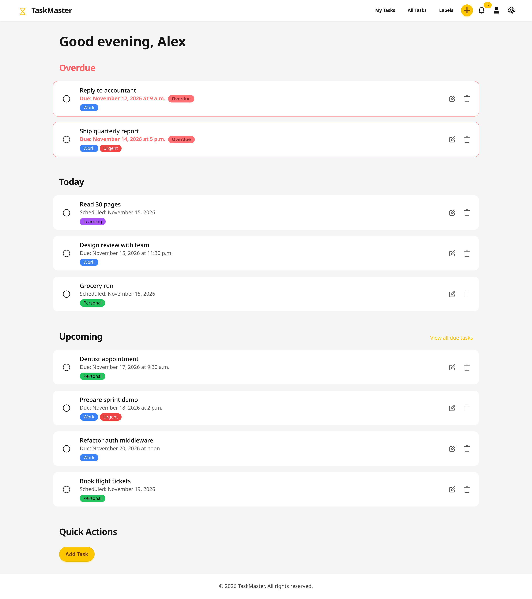
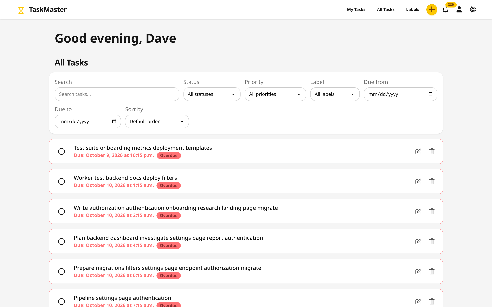
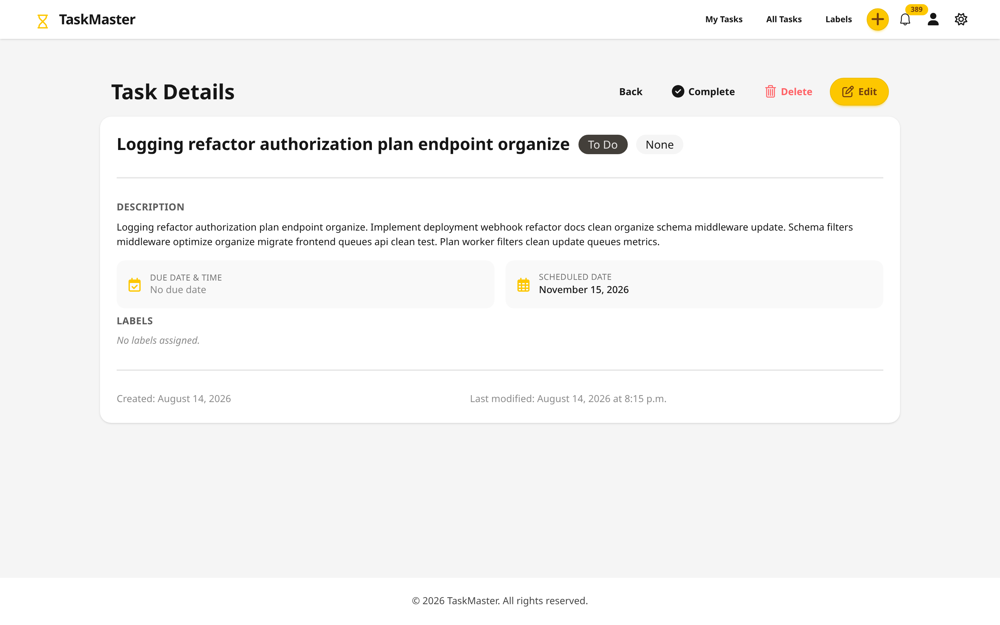
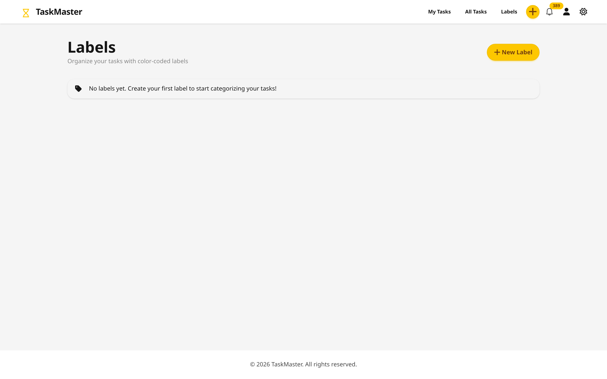
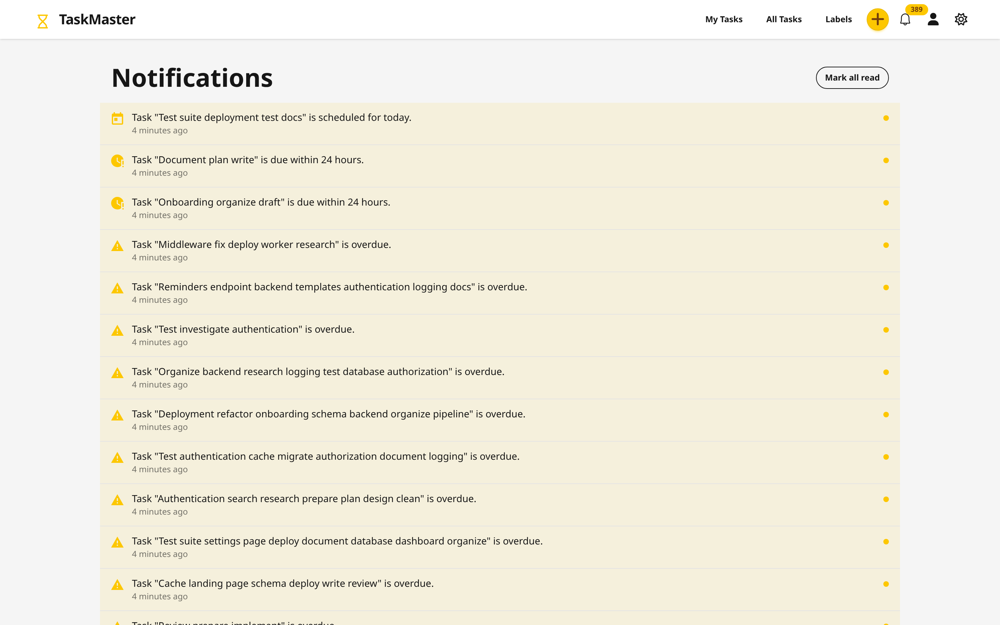
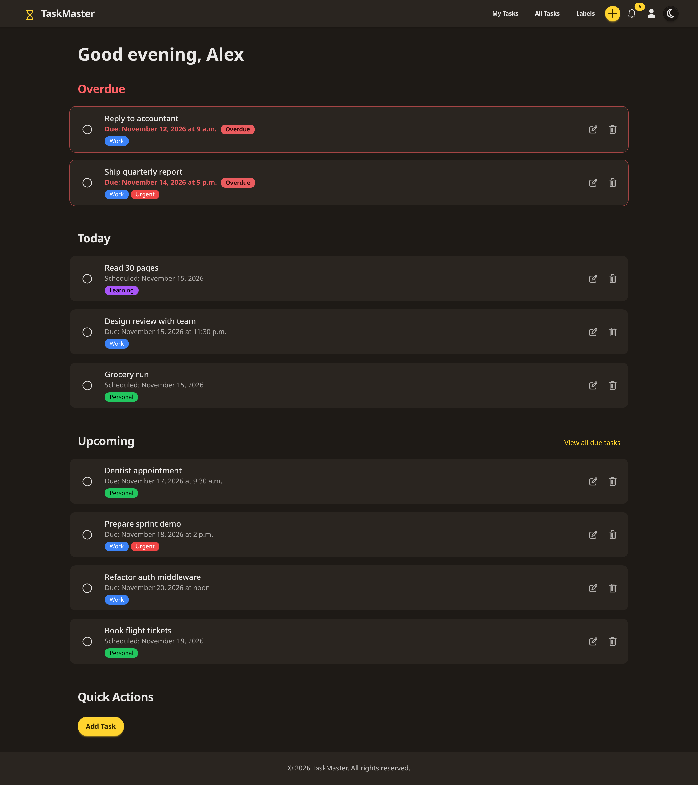
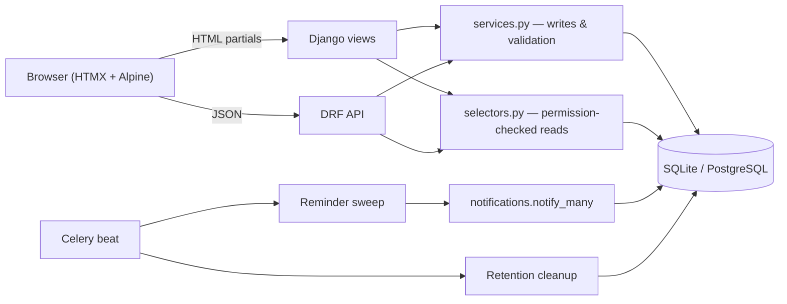

# TaskMaster

A full-stack task management application built with Django and HTMX — color-coded
labels, searchable and filterable task lists, automatic reminders, in-app
notifications, and a REST API, wrapped in a Tailwind CSS v4 + daisyUI interface
with light and dark themes.

[](https://github.com/andrew-anter/TaskMaster/actions/workflows/ci.yml)
[](https://www.python.org/)
[](https://www.djangoproject.com/)
[](LICENSE)
[](https://github.com/astral-sh/ruff)



## Highlights

- **Service/selector architecture** — business rules live in transactional,
  keyword-only service functions; reads go through permission-checked selectors
  that raise instead of returning `None`. Views and the API orchestrate, never
  duplicate logic.
- **HTMX-first frontend** — every mutation re-renders exactly the region it came
  from (dashboard, filtered list, label page, or task detail), with full-page
  fallbacks when JavaScript is unavailable.
- **Generic notification subsystem** — any app can emit notifications through
  `notify()` / `notify_bulk()` with database-enforced dedupe keys, a cached
  unread badge invalidated on every write path, and retention cleanup.
- **Celery reminders** — a periodic sweep generates overdue / due-today /
  due-soon / scheduled-today reminders, idempotent at the database level and
  isolated per user so one failure never starves the rest.
- **Multi-tenant safety** — ownership is enforced in the service layer for tasks
  and labels alike; the API cannot attach another user's labels.
- **Quality gates** — pytest (service, view, and API levels), Ruff lint +
  format, basedpyright, and bandit all run in CI on every push and PR.

## Features

- **Tasks** — title, description, status, priority, due date & time, scheduled
  date, and multiple labels; quick done/undone toggle; inline editing on the
  detail page.
- **My Tasks dashboard** — today's, upcoming, and overdue sections that never
  render the same task twice.
- **Search, filters & pagination** — keyword, status, priority, label, and
  due-date range filters with sortable columns and back/forward-friendly URLs.
- **Labels** — color-coded, unique per user, assignable from the task form via
  an inline create-and-pick flow.
- **Notifications** — navbar bell with a live unread badge, dropdown panel, full
  list page, mark-one / mark-all read.
- **Accounts** — register, log in with username or email, password reset,
  optional Google sign-in (django-allauth), and brute-force login lockout.
- **REST API** — paginated CRUD at `/tasks/api/v1/` with Session or Basic auth.
- **Light/dark themes** — persisted per browser.

## Screenshots

| All tasks & filters | Task detail |
|---|---|
|  |  |

| Labels | Notifications | Dark theme |
|---|---|---|
|  |  |  |

## Tech stack

| Layer | Technology |
|---|---|
| Backend | Python 3.13, Django 5.2, Django REST Framework |
| Frontend | HTMX, Alpine.js, Tailwind CSS v4, daisyUI |
| Auth | django-allauth (username/email + Google), Argon2 hashing |
| Async jobs | Celery + Redis/Valkey (reminders, retention cleanup) |
| Database | SQLite (dev) / PostgreSQL (production) |
| Tooling | uv, Ruff, basedpyright, bandit, pytest, GitHub Actions |

## Architecture



```
tasks/          Core task management (models, services, selectors, views, API, Celery reminders)
labels/         Color-coded labels (class-based service/selector)
notifications/  Generic notification subsystem (emitter API, signals, retention, UI)
accounts/       Authentication, registration, login lockout
common/         Shared HTTP helpers, pagination, middleware
core/           Settings, URLs, Celery app
templates/      Server-rendered pages + HTMX partials
docs/           Design specs and screenshots
```

## Quickstart

**Prerequisites:** Python 3.13+ and [uv](https://docs.astral.sh/uv/).

```bash
git clone https://github.com/andrew-anter/TaskMaster.git
cd TaskMaster
uv sync
cp core/.env.example core/.env   # defaults work out of the box for local dev
uv run python manage.py migrate
./build-css.sh build             # compiled CSS is not committed
make dev                         # Django + Celery worker/beat (eager, no broker needed)
```

Open <http://127.0.0.1:8000/> and register an account.

In development an empty `SECRET_KEY` is replaced by an ephemeral per-process
key; production (`DEBUG=False`) refuses to start without a real one.

### Demo data

Seed 100 users, 50 labels, and 100,000 tasks with realistic dates, plus
reminder notifications:

```bash
uv run python manage.py seed_data --password 'demo-pass-123'
```

`--password` is opt-in and gives every seeded user a usable password — log in
as **`seed_user_1`** with the password you passed to explore the app at demo
scale. Re-running the command is idempotent for users and labels (it only adds
tasks); `--flush` removes all seeded data first. Tune the volume with
`--users / --labels / --tasks`, and make it deterministic with `--seed 42`.

## Docker

```bash
docker build -t taskmaster .
docker run --rm -p 8000:8000 -e SECRET_KEY="$(python -c 'import secrets; print(secrets.token_urlsafe(50))')" taskmaster
```

The entrypoint applies migrations and creates the cache tables on startup.
When running worker/beat containers from the same image, set
`RUN_MIGRATIONS=0` there so only the web container migrates:

```bash
docker run --rm -e RUN_MIGRATIONS=0 -e CELERY_BROKER_URL=redis://host:6379/0 taskmaster celery -A core worker -B -l info
```

## REST API

Authenticated with Session or Basic auth; throttled at 100/hour (anonymous)
and 1000/hour (authenticated).

| Method | Endpoint | Description |
|---|---|---|
| GET | `/tasks/api/v1/` | List your tasks — paginated, 50 per page |
| POST | `/tasks/api/v1/` | Create a task — `201` with the created task; `400` on past dates or another user's labels |
| GET | `/tasks/api/v1/<pk>/` | Retrieve one task |
| PATCH | `/tasks/api/v1/<pk>/` | Partial update — `200` with the task, bodyless `304` when nothing changed |
| DELETE | `/tasks/api/v1/<pk>/` | Delete — `204` |
| POST | `/tasks/api/v1/<pk>/toggle/` | Toggle TODO ↔ COMPLETED |

```bash
curl -u seed_user_1:demo-pass-123 http://127.0.0.1:8000/tasks/api/v1/
```

## Development

| Command | Purpose |
|---|---|
| `make dev` | Server + Celery worker/beat with eager tasks |
| `make test` | Run the pytest suite |
| `make lint` / `make format` | Ruff with autofix / formatter |
| `make lint-check` / `make format-check` | Read-only checks (used by CI) |
| `make typecheck` | basedpyright |
| `make security` | bandit (test fixtures excluded) |
| `make check` | All read-only checks + tests |
| `make css` | Rebuild Tailwind CSS after template changes |
| `make worker-beat` | Celery worker + beat against a real broker |

Tests cover services, views, and the API directly — including ownership
boundaries, dedupe races, dashboard disjointness, lockout behavior, and
notification cache invalidation. Configuration lives in `core/.env`
(see `core/.env.example` for every variable: database, broker, cache,
throttling, retention windows, proxy trust, Google OAuth, email).

## License

[MIT](LICENSE) © Andrew Anter